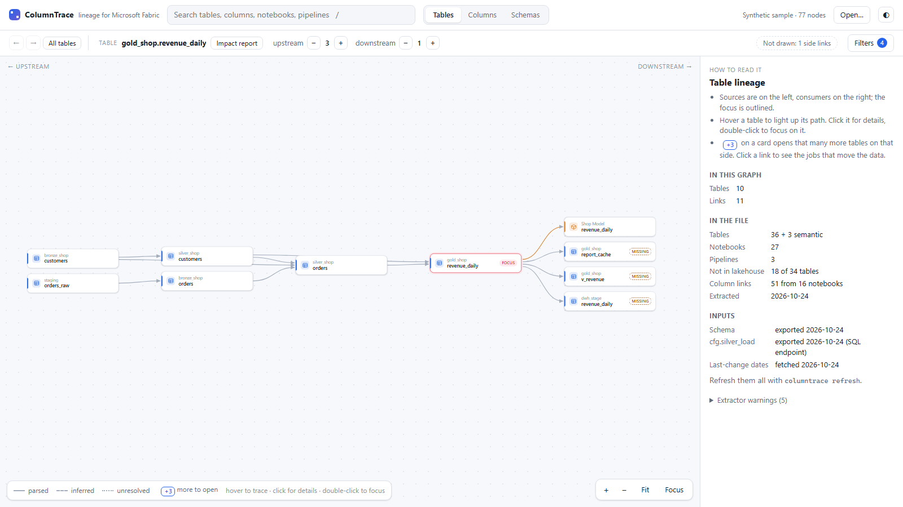
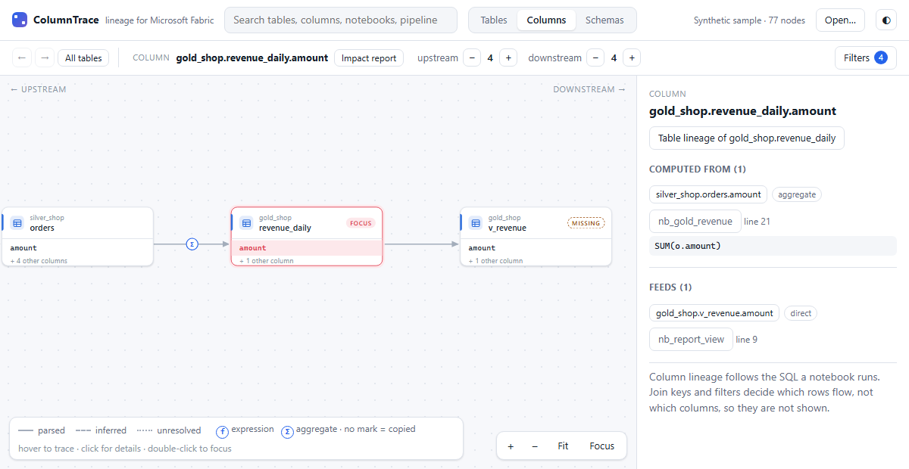

# ColumnTrace

**Table and column lineage for Microsoft Fabric, read straight from your git-integration folder.**

ColumnTrace reads the item definitions Fabric commits to git (notebooks, data pipelines, semantic
models), works out which tables and columns feed which, and shows it in a browser. It answers two
questions before you change something:

- *If I change or drop this table or column, what breaks downstream?*
- *Where does this number come from?*

It is read-only: it never connects to a workspace to change anything, and every link it draws says
how sure it is (`parsed`, `inferred` or `unresolved`) instead of guessing silently.

```text
Fabric git folder ──┐
last-change dates ──┤   (optional)
schema export ──────┼──>  columntrace extract  ──>  lineage.json  ──>  browser UI
config-table rows ──┘   (optional)                                      Tables · Columns · Schemas · All tables
```

**Try it now:** the [live demo](https://dev2353.github.io/columntrace/), or open [`demo/index.html`](demo/index.html) locally. It is one self-contained page
with a synthetic workspace (no install, no server).



*Tables view: one table in focus, its sources on the left and its consumers on the right.*



*Columns view: where a number comes from, with the expression (`SUM(o.amount)`) and the notebook line.*

## Quick start

```bash
pip install -e ".[dev]"
python -m pytest                                     # runs against a synthetic workspace

columntrace extract --repo <fabric-git-folder> --out lineage.json
columntrace impact lineage.json silver_sales.orders  # Markdown impact report in the terminal

cd ui && npm install && npm run dev                  # http://localhost:5173, opens the synthetic sample
```

Drop your `lineage.json` on the page (or use **Open…**). Files are read in the browser and never
uploaded. To set it up for your own workspace with an AI coding agent, see [PROMPT.md](PROMPT.md).

## What you see

**Tables view.** Pick a table: what flows into it sits on the left, what it feeds on the right, one
level per job. Notebooks and pipelines are folded into the links, so the picture shows data, not
plumbing. Hover a table to light up its whole path, click it for details, double-click to re-center
on it. A `+3` on a card opens three more tables on that side.

**Columns view.** Tables become cards listing the traced columns, and links join column rows. A mark on
a link says how the column is computed (`f` an expression, `Σ` an aggregate, none when copied as is);
hover it for the SQL. Searching `table.column` jumps straight here.

**Schemas view.** One box per schema, links counting the table flows between them.

**All tables.** Every table in one list: filter by name or schema, sort by how connected it is, or show
only sources, tables nothing reads, or tables with column lineage. **←** and **→** step back and forward
through what you looked at.

**Side panel.** For a table: the notebooks and pipelines that write and read it (status, last change,
file and line), its columns, any config-table warning, and an impact report (downstream and upstream,
strict and loose) to copy as Markdown or CSV. For a job: the tables it reads and writes and its
variants (`x`, `x_python`, `x_v2`).

**Filters.** An editable list of name rules to hide tables (views, temp tables, backups to start
with; add your own, switch them off, see how many tables each matches), job status filters, and
evidence levels. A line above the graph counts what is not drawn and why.

## Keeping it current

One settings file says where everything comes from; one command refreshes it all:

```bash
cp refresh.example.toml ../my-workspace/refresh.toml     # fill it in once; keep it out of the repo
columntrace refresh --config ../my-workspace/refresh.toml
```

It pulls the branch head, re-exports dates, schema and config tables (all read-only), rebuilds
`lineage.json`, keeps the previous file and prints what changed. `--skip dates,schema` reuses the
last exports; `--offline` only re-extracts. Reload the page to see the new graph.

## Team defaults

Put a `team-defaults.json` next to `lineage.json` (copy [`ui/team-defaults.example.json`](ui/team-defaults.example.json))
and everyone who opens the page starts from the same settings: the first table, the depth, the name rules
and an always-show list, the job and evidence filters, and the broad-job limit. Every key is optional.

- `depth: "auto"` sizes each side on its own: at least the first hop, then deeper while that side stays
  within `tablesPerSide` tables (50 by default), stopping once a further hop adds nothing.
- Each viewer can still change the filters. Their own name rules are remembered in their browser until
  the team file changes; **Reset filters** goes back to the team defaults.
- `single-page.mjs --defaults team-defaults.json` puts the file inside a one-page build as well.

## Repository layout

```text
columntrace/
├── README.md               this file
├── PROMPT.md               prompts to set it up (or rebuild it) with an AI coding agent
├── CONTRIBUTING.md         layout, fixtures, tests, the pre-publish check
├── LICENSE                 MIT
├── pyproject.toml          package, extras (dev, sql, onelake), ruff and pytest settings
├── refresh.example.toml    settings template for `columntrace refresh`
├── .github/workflows/
│   ├── ci.yml              lint, tests, fixture regeneration check, leak check, UI tests and build
│   └── pages.yml           publishes demo/ to GitHub Pages
├── demo/
│   └── index.html          self-contained demo page (UI + synthetic sample), opens from disk
├── docs/
│   ├── how-it-works.md     extraction, confidence, liveness, column lineage, config tables, limits
│   ├── cli.md              every command and option
│   ├── lineage-format.md   the lineage.json contract between extractor and UI
│   └── img/                screenshots used in this README (synthetic sample)
├── src/columntrace/        the extractor (Python, one dependency: sqlglot)
│   ├── cli.py              command line entry point
│   ├── extract.py          walks the repo and builds the graph
│   ├── model.py            Graph, Node, Edge, flows, column edges; writes lineage.json
│   ├── notebooks.py        notebook cells: SQL, Python calls, temp views, DataFrame chains
│   ├── strings.py          evaluates f-strings, .format, constants, parameter defaults, split()
│   ├── sql_refs.py         table references in SQL (sqlglot, regex fallback)
│   ├── columns.py          column lineage through CTEs, unions, MERGE and temp views
│   ├── pipelines.py        pipeline JSON: notebook and pipeline calls, Copy, Lookup, Script
│   ├── semantic.py         semantic model TMDL tables and their sources
│   ├── config_resolver.py  load_cfg JSON and exported config tables (flows, warnings)
│   ├── liveness.py         status, variant families, stale flags
│   ├── gitdates.py         last-change dates from Azure DevOps
│   ├── schema_export.py    INFORMATION_SCHEMA.COLUMNS export
│   ├── table_export.py     one config table through the SQL endpoint
│   ├── delta_export.py     one config table from OneLake Delta files (whole text)
│   ├── refresh.py          every step from one settings file, plus the change report
│   └── impact.py           upstream and downstream walk, Markdown report
├── tests/                  pytest suites, all on synthetic data
├── fixtures/               synthetic "Contoso Shop" workspace, ground truth, dates, schema, config rows
├── tools/
│   ├── make_fixtures.py    regenerates fixtures/ and ui/public/sample-lineage.json
│   └── check_public.py     pre-publish leak check
└── ui/                     React + TypeScript + Vite, no graph library
    ├── src/App.tsx         toolbar, views, history, data loading
    ├── src/components/     LineageCanvas, TableCatalog, SidePanel, FilterPanel, ImpactModal
    ├── src/lib/            view building, layout, exclusions, navigation, reports (+ lib.test.ts)
    ├── public/sample-lineage.json   the synthetic sample the dev server opens
    └── scripts/single-page.mjs      builds one self-contained HTML page
```

## Commands and scripts

### Python (`columntrace …`)

| Command | What it does | Talks to |
| --- | --- | --- |
| `extract --repo <folder> --out lineage.json` | Builds the graph from a Fabric git folder; options add dates, schema, config tables | nothing (local files) |
| `refresh --config refresh.toml` | Runs pull, dates, schema, config and extract from one settings file; prints a change report | git remote, Azure DevOps, SQL endpoint, OneLake (all read-only) |
| `impact lineage.json <table>` | Markdown report of everything downstream and upstream | nothing |
| `stats lineage.json` | Counts of nodes and edges by type | nothing |
| `fetch-dates --org … --project … --repo …` | Last-change date per item folder, about one API call per folder | Azure DevOps |
| `export-schema --server … --database …` | Every table and column: one `INFORMATION_SCHEMA.COLUMNS` query | SQL endpoint |
| `export-table --server … --database … --table cfg.x` | Rows of one config table; flags text cut at 8,000 characters | SQL endpoint |
| `export-delta --workspace … --lakehouse … --table cfg.x` | The same table read from its Delta files, every value whole | OneLake |

Options for each are in [docs/cli.md](docs/cli.md). Auth for the network commands is your own
`az login` (or a token in an environment variable).

### Tools

| Script | What it does |
| --- | --- |
| `python tools/make_fixtures.py` | Rewrites the synthetic workspace, its ground truth and the UI sample on a fixed clock, so the files only change when the fixtures or the extractor do |
| `python tools/check_public.py` | Scans the files git would publish for ids, endpoint hosts, e-mail addresses, home folders, tokens and private files; your own words go in the git-ignored `.publiccheck.local` |

### UI (`cd ui`)

| Script | What it does |
| --- | --- |
| `npm run dev` | Dev server on port 5173 with the synthetic sample; `?data=/@fs/<path>` opens a private file (see `ui/.env.example`) |
| `npm test` | Unit tests for the view, layout, exclusion, navigation and report logic |
| `npm run build` | Type-checks and builds `ui/dist` |
| `npm run build:demo` | Builds and writes `demo/index.html` with the synthetic sample embedded |
| `node scripts/single-page.mjs --out page.html [--embed lineage.json] [--fragment]` | One-page build of the UI; `--embed` puts a lineage file inside the page, `--fragment` leaves out the document wrapper for hosts that add their own |

### CI

`.github/workflows/ci.yml` runs on every push: ruff, pytest on Python 3.11 to 3.13, a check that
`tools/make_fixtures.py` gives exactly the committed fixtures and sample, the leak check, and the UI
tests and build.

## Accuracy

The tests extract the synthetic workspace (25 notebooks, 3 pipelines, a semantic model and config
tables) and compare it with hand-labelled ground truth: table edges and column edges must match
exactly, with no misses and no extras. The fixtures cover the hard cases: temp views, f-strings and
parameter defaults, `split()` unpacking, MERGE, UNION, unknown schemas, config-driven loaders and
PySpark/Python twins. A separate test checks that repeated runs give identical column lineage.

## Limits

- PySpark DataFrame transformations (`select`, `withColumn`, joins) are not traced at column level, and
  tables written by non-SQL code (pandas, delta-rs) have no column lineage.
- Names built at run time stay `unresolved` nodes with their template. Parameter defaults are taken at
  face value.
- Liveness, staleness and dates come from the repo (schedules, calls, commits): hints, not proof of use.
- Lakehouse shortcuts, `.ipynb` notebooks and report (PBIR) definitions are not parsed yet.

## Privacy

Only synthetic data is in this repository. Keep real workspace folders and generated files in an
ignored location (`data/`, `out/`, `*.private.*`); `--no-evidence` strips code snippets from
`lineage.json` before you share it. A page built from real data holds all of that lineage: share it
only where your data may go.

## License

[MIT](LICENSE)
